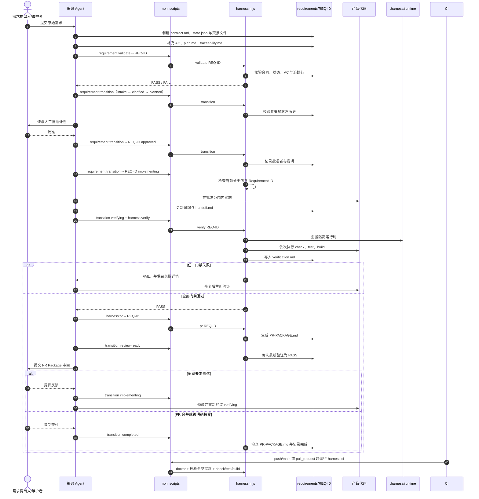

# 需求交付 Harness

本目录提供一套“需求到 PR”的可审计交付流程。它把需求合同、人工批准、实现、验证、审阅与完成状态保存在仓库中，让本地 Agent、维护者和 CI 使用同一套命令与证据。

> [!IMPORTANT]
> 本文是使用说明，不是新的规则来源。仓库级约束以 [`AGENTS.md`](../AGENTS.md) 为准，生命周期和门禁以 [`PROCESS.md`](./PROCESS.md) 为准；如有冲突，应以这两个文件为准。

## 整体流程

一个需求对应 `requirements/<Requirement ID>/` 下的一组合同与证据文件，并在 `requirement/<Requirement ID>-<short-name>` 独立分支中实施。正常生命周期为：

```text
intake -> clarified -> planned -> approved -> implementing -> verifying -> review-ready -> completed
```

下图展示参与者、命令入口、脚本和文件之间的主要调用关系。图中的“维护者批准”是修改产品代码前不可跳过的人工边界。



## 文件和目录分别做什么

| 文件或目录 | 职责 | 主要读写关系 |
| --- | --- | --- |
| [`AGENTS.md`](../AGENTS.md) | 所有编码 Agent 的仓库入口与强制约束。 | Agent 开工前读取；不由 Harness 脚本改写。 |
| [`harness/PROCESS.md`](./PROCESS.md) | 生命周期、状态门禁、风险等级和例外策略的权威定义。 | 人和 Agent 读取；工具专用文档只能引用它。 |
| [`package.json`](../package.json) | 暴露稳定的 `npm run` 命令，将参数转发给 Harness。 | 人、Agent 和 CI 调用；最终进入 `harness.mjs`。 |
| [`harness/scripts/harness.mjs`](./scripts/harness.mjs) | Harness 的可执行核心：校验需求、约束转换、重置运行时、执行门禁、生成验证证据和 PR Package。 | 读取需求文件和 Git 状态；写入 `state.json`、`verification.md`、`PR-PACKAGE.md` 与隔离运行时。 |
| [`harness/schemas/state.schema.json`](./schemas/state.schema.json) | 描述 `state.json` 的机器可读结构，供编辑器或外围工具使用。 | 当前核心脚本自行执行必要状态校验；schema 是外部集成的结构契约。 |
| [`harness/templates/requirement/`](./templates/requirement/) | 新需求的合同、计划、状态、追踪、验证、审阅与交接模板。 | `requirement:new` 复制到新的 `requirements/<ID>/` 并填入 ID 与来源，其余占位内容在澄清阶段替换。 |
| [`.harness-agent.yaml`](../.harness-agent.yaml) | Harness Agent 接入清单，向它描述本 Harness 的状态、命令、目录与受保护路径。 | Harness Agent 读取；只描述现有规则，不是新的规则来源。 |
| [`harness/templates/PULL_REQUEST.md`](./templates/PULL_REQUEST.md) | 通用 PR 描述模板。 | 供提交 PR 时参考；自动生成的需求证据位于对应的 `PR-PACKAGE.md`。 |
| [`harness/templates/exception.md`](./templates/exception.md) | 门禁例外记录模板。 | 仅在门禁失败后获得明确批准时使用，记录影响、补偿验证、批准者和到期条件。 |
| `requirements/<Requirement ID>/` | 单个需求的权威状态与完整证据链。 | `validate` 读取整套文件；`transition`、`verify` 和 `pr` 分别更新状态、验证证据和 PR Package。 |
| `.harness/runtime/` | 自动化测试和基准的可丢弃隔离数据区。 | `harness:reset` 与 `harness:verify` 可安全重建；不得替代或访问真实 Electron `userData`。 |
| [`harness/tests/`](./tests/) | Harness 及产品验收的自动化测试。 | `npm test` 使用 Node 内置测试运行器执行 `*.test.mjs`。 |
| [`.github/workflows/harness.yml`](../.github/workflows/harness.yml) | PR 与 `main` 推送时的 CI 门禁。 | 安装锁定依赖后运行 `npm run harness:ci`。 |

### 单个需求目录

| 文件 | 内容与写入者 |
| --- | --- |
| `contract.md` | 需求目标、范围、约束、风险和编号为 `AC-001` 等的验收标准；由 Agent 规范化，维护者确认。 |
| `state.json` | 当前状态、风险和不可丢失的转换历史；只能通过 `requirement:transition` 推进。 |
| `plan.md` | 经批准的实现步骤、验证方式与回退策略。 |
| `traceability.md` | 每条 AC 到实现位置、验证方式和结果的映射。 |
| `verification.md` | `harness:verify` 自动覆盖写入的最新门禁摘要和失败详情。 |
| `review-feedback.md` | 审阅发现、决定、后续动作和处理状态。 |
| `handoff.md` | 跨会话保存当前状态、决策、失败命令和精确下一步；聊天记录不能替代它。 |
| `PR-PACKAGE.md` | `harness:pr` 汇总合同链接、变更路径、追踪矩阵、验证、风险和例外后生成的审阅包。 |

## 命令如何调用脚本

以下命令均由 `package.json` 转发到 `node harness/scripts/harness.mjs <command>`：

| npm 命令 | 内部命令 | 作用 |
| --- | --- | --- |
| `npm run harness:doctor` | `doctor` | 检查 Node 22+、Git 和必需入口文件。 |
| `npm run requirement:new -- REQ-0006 <source> [actor]` | `new REQ-0006 <source> [actor]` | 从模板建档，写入来源，状态为 `intake`；actor 缺省为 `maintainer`。ID 非法、目录已存在或缺少来源时失败。 |
| `npm run requirement:validate -- REQ-0004` | `validate REQ-0004` | 校验目录、合同 frontmatter、状态、AC 和追踪行。 |
| `npm run requirement:status -- REQ-0004` | `status REQ-0004` | 输出当前 `state.json`。 |
| `npm run requirement:transition -- REQ-0004 planned Codex "note"` | `transition REQ-0004 planned Codex note` | 校验转换合法性，并将操作者和说明追加到状态历史。 |
| `npm run harness:reset` | `reset` | 仅重建 `.harness/runtime/`。 |
| `npm run harness:verify -- REQ-0004` | `verify REQ-0004` | 要求状态为 `verifying`，重置运行时，依次运行 `check`、`test`、`build` 并写入证据。 |
| `npm run harness:pr -- REQ-0004` | `pr REQ-0004` | 在 `verifying` 或 `review-ready` 状态生成 `PR-PACKAGE.md`。 |
| `npm run harness:benchmark` | `benchmark` | 重复校验全部需求并输出耗时数据。 |
| `npm run harness:ci` | `ci` | 执行环境检查、校验所有需求，再运行类型检查、测试和构建。 |

在 PowerShell 中，如果执行策略阻止 `npm.ps1`，可使用同一安装中的 `npm.cmd`，例如 `npm.cmd run harness:doctor`；这不会改变 Harness 行为。

## 状态与门禁

- `intake`：原始请求已建档。
- `clarified`：合同完整，AC 已编号且无未解决歧义。
- `planned`：计划完成，每条 AC 均有追踪行。
- `approved`：状态历史记录人工批准者；此状态之前不得修改产品代码。自动化身份 `Codex` 与 `harness-agent` 不能推进到 `approved` 或 `completed`。
- `implementing`：脚本额外检查当前 Git 分支名包含 Requirement ID。
- `verifying`：实现与追踪已更新，允许执行完整门禁。
- `review-ready`：最新 `verification.md` 必须是 PASS。
- `completed`：PR 已合并或维护者明确接受，并且存在 `PR-PACKAGE.md`。

`blocked` 保存 `blockedFrom`，解除阻塞后只能返回原状态。`cancelled` 和 `completed` 是终态。审阅反馈可以让 `review-ready` 返回 `implementing`，但修改后必须重新经过 `verifying`。

门禁失败不是可以删除的噪声：`verification.md` 会保留失败命令的输出摘要，`handoff.md` 应记录失败尝试和下一步。若确实需要例外，必须先获得批准，再按 `templates/exception.md` 留下可审计记录；风险专用检查只能增加门禁，不能削弱通用门禁。

## 推荐操作顺序

```powershell
# 1. 安装锁定依赖并检查环境
npm ci
npm run harness:doctor

# 2. 建档，完善合同、计划和追踪后校验
npm run requirement:new -- REQ-XXXX "https://github.com/xXFengXx/Starter-Codex/issues/<n>"
npm run requirement:validate -- REQ-XXXX
npm run requirement:status -- REQ-XXXX

# 3. 按顺序转换 clarified、planned，取得人工批准后再进入 approved
npm run requirement:transition -- REQ-XXXX clarified Codex "Contract clarified"
npm run requirement:transition -- REQ-XXXX planned Codex "Plan and traceability ready"
npm run requirement:transition -- REQ-XXXX approved maintainer "Plan approved"

# 4. 在 requirement/REQ-XXXX-short-name 独立分支实施
npm run requirement:transition -- REQ-XXXX implementing Codex "Implementation begins"

# 5. 更新追踪与交接后进行隔离验证
npm run requirement:transition -- REQ-XXXX verifying Codex "Implementation ready for gates"
npm run harness:verify -- REQ-XXXX

# 6. 生成并审阅 PR Package
npm run harness:pr -- REQ-XXXX
npm run requirement:transition -- REQ-XXXX review-ready Codex "All mandatory gates passed"

# 7. PR 合并或被明确接受后完成
npm run requirement:transition -- REQ-XXXX completed maintainer "PR accepted"
```

如果任一命令失败，应停止向后转换，修复问题或记录经批准的例外。会话在需求未完成时结束，则必须更新该需求的 `handoff.md`。

## 由 GitHub Issue 驱动

Harness Agent 通过 [`.harness-agent.yaml`](../.harness-agent.yaml) 接入，可以按上述顺序代为执行：维护者给 Issue 加 `agent:plan` 后，它调用 `requirement:new` 建档并让 Codex 走到 `planned`；维护者在 Issue 下评论 `/approve REQ-XXXX` 后，它以评论者的 GitHub 登录名执行 `approved`，再实施、验证并提交 Draft PR。批准规则见 [`PROCESS.md`](./PROCESS.md#批准者)。合并与 `completed` 仍由维护者完成。
